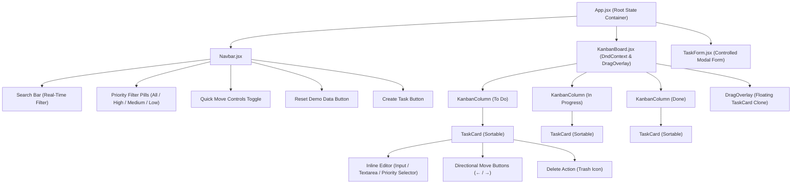

# Prodesk IT — Sprint 5 | Enterprise Kanban Board

A production-grade, Trello-style **Kanban Task Board** web application built with **React 18+ (Vite)**, **Tailwind CSS**, **Lucide Icons**, and **@dnd-kit**.

Designed and engineered for **Prodesk IT — Sprint 5** under strict QA compliance:
- **Zero Imperative DOM Manipulation:** 100% pure declarative React state.
- **Native State Management:** Zero external store libraries (no Redux, no Zustand); fully powered by `useState`, `useEffect`, `useMemo`, **Props**, and **Lifting State Up**.
- **Tactile Drag-and-Drop:** Smooth physics-based reordering and cross-column transitions powered by `@dnd-kit` with `DragOverlay`.
- **Instant Vercel Deployment:** Configured with `vercel.json` SPA rewrites and verified with 0-warning production builds.

---

## 📸 Interface Preview

- **3 Dedicated Sprint Columns:** `To Do`, `In Progress`, and `Done`
- **Conditional Priority Styling:**
  - 🔴 **High Priority:** `border-l-4 border-red-500 border-red-500/60` + red pill badge
  - 🟡 **Medium Priority:** `border-l-4 border-yellow-400 border-yellow-400/60` + yellow pill badge
  - 🟢 **Low Priority:** `border-l-4 border-emerald-500 border-emerald-500/60` + emerald pill badge
- **Inline Editing Mode:** Click directly on any task title or pencil icon to edit Title, Description, Priority, and Tags in-place.
- **Dual Interaction Modes:** Simultaneous support for P0 Quick Directional Move Buttons (`←` / `→`) and P2 Drag-and-Drop.

---

## 🏗️ Component Hierarchy Diagram



---

## 🎯 Feature Matrix (P0 / P1 / P2)

### Phase 1 (P0): Base MVP & Component Logic
- [x] **3-Column Board:** Fully responsive columns for `To Do`, `In Progress`, and `Done`.
- [x] **Add Task:** Controlled form capturing task Title, optional Description, Priority (`High`, `Medium`, `Low`), and Category Tags.
- [x] **Delete Task:** Dedicated delete button with immediate, smooth state removal.
- [x] **Directional Move Controls:** Sleek `←` and `→` buttons on every card to advance or return tasks across columns.
- [x] **P0 / P2 Dual Interaction Toggle:** Header switch allowing evaluators to demonstrate P0 arrow buttons alongside P2 Drag-and-Drop.

### Phase 2 (P1): UI/UX Polish & State Persistence
- [x] **Inline Task Editing:** Click title or pencil icon to edit Title, Description, and Priority directly on the card with `Enter` (save) and `Escape` (cancel) shortcuts.
- [x] **Conditional Priority CSS Borders (Critical QA Check):**
  - **High:** `border-l-4 border-red-500 border-red-500/60`
  - **Medium:** `border-l-4 border-yellow-400 border-yellow-400/60`
  - **Low:** `border-l-4 border-emerald-500 border-emerald-500/60`
- [x] **Persistent State (`localStorage`):**
  - Lazy initializer reads from `localStorage.getItem('prodesk_kanban_tasks')`.
  - Automatically seeds 5 realistic software engineering tasks across `To Do`, `In Progress`, and `Done` when first loaded.
  - Automatically synchronizes all mutations (add, edit, delete, move, reorder) via `useEffect`.
- [x] **Reset Demo Data:** One-click button to restore initial 5 sprint tasks.

### Phase 3 (P2): Advanced Interactions & Real-Time Filtering
- [x] **Modern Drag-and-Drop (`@dnd-kit`):**
  - Physical dragging across columns and vertical reordering within columns.
  - Tactile `DragOverlay` with subtle tilt and elevation shadows.
  - Pointer sensors configured with `distance: 5` constraint to ensure smooth button clicks and input focus without accidental drags.
- [x] **Real-Time Data Filtering:**
  - Global search bar filtering across all three columns in real time.
  - Quick-filter priority pills (`All`, `High`, `Medium`, `Low`) with dynamic count badges.
  - Contextual empty-state display when columns contain zero matching tasks.

---

## 🚀 Getting Started Locally

### Prerequisites
- Node.js 18+ installed
- npm or yarn

### 1. Installation
```bash
npm install
```

### 2. Run Development Server
```bash
npm run dev
```
Open your browser and navigate to `http://localhost:5173`.

### 3. Build for Production
```bash
npm run build
```
Creates an optimized production bundle inside the `dist/` directory.

### 4. Preview Production Build
```bash
npm run preview
```

---

## 🌐 Deploying to Vercel

This repository is 100% pre-configured for instant zero-configuration deployment on **Vercel**:

### Method 1: Vercel CLI
```bash
npm install -g vercel
vercel
```

### Method 2: Vercel Dashboard (Git Integration)
1. Push this repository to GitHub or GitLab.
2. In the [Vercel Dashboard](https://vercel.com), click **Add New Project**.
3. Import this repository.
4. Framework Preset will automatically detect **Vite**.
5. Build command: `npm run build`
6. Output directory: `dist`
7. Click **Deploy**.

> The included `vercel.json` provides automatic SPA rewrite rules (`/(.*)` -> `/index.html`), ensuring client-side routes and browser refreshes work flawlessly.

---

## 📄 Documentation Deliverable
For detailed architectural rationale, code explanations of Props & Lifting State Up, `localStorage` lazy initialization, and `@dnd-kit` multi-column algorithms, refer to [Prompts.md](file:///d:/My%20Company%20work/Sprint%205/Prompts.md).
